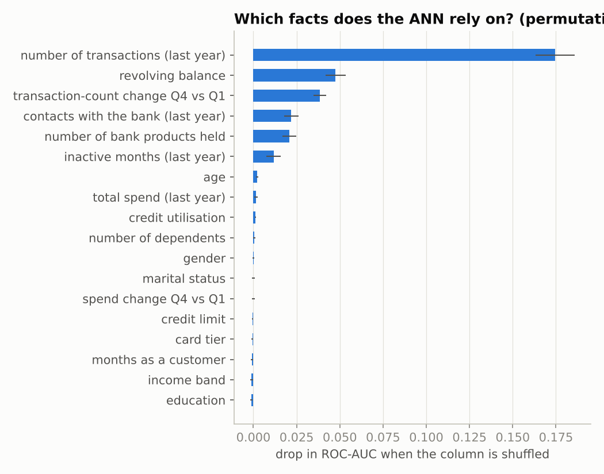
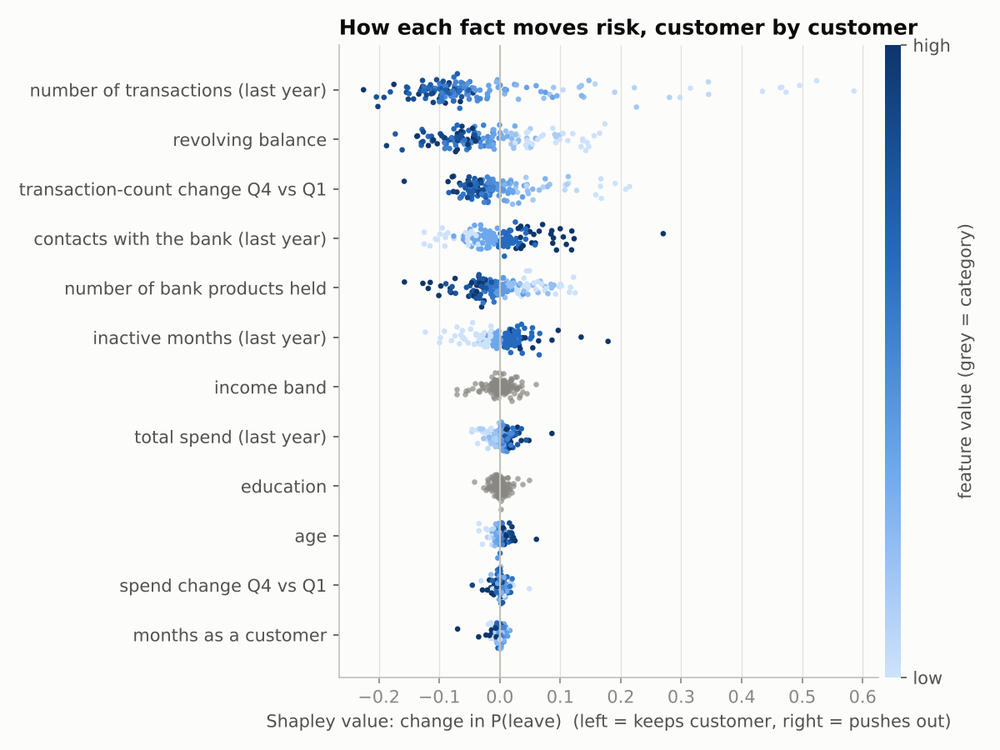
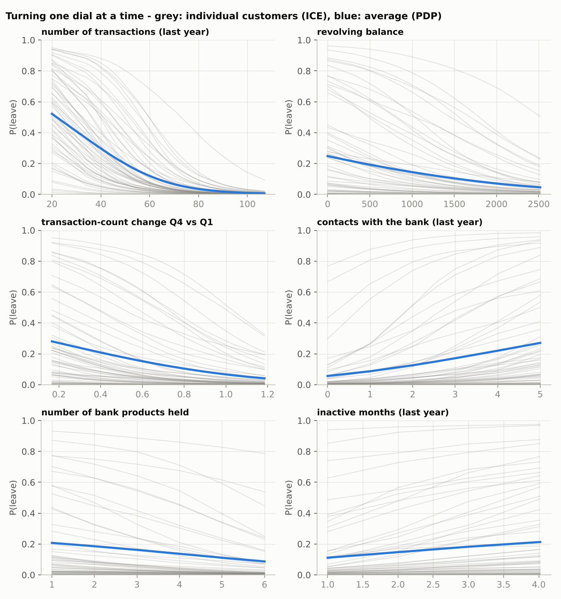
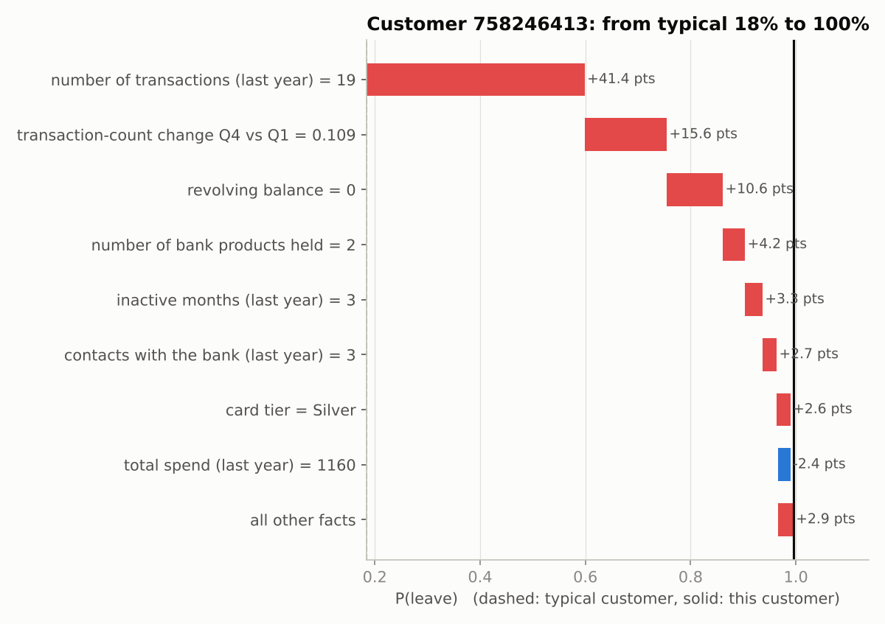
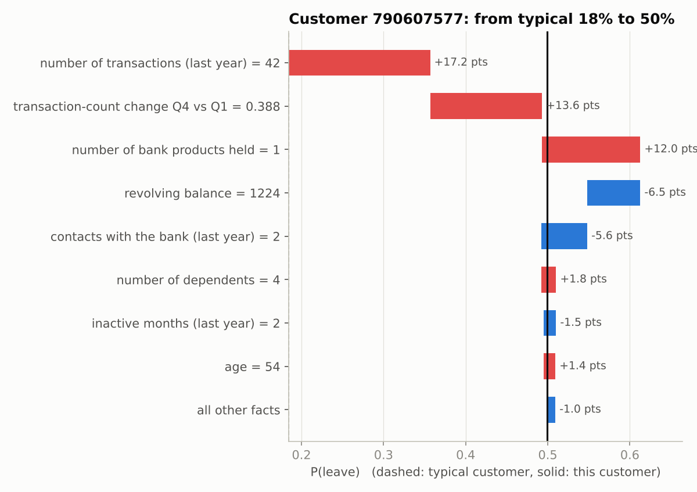
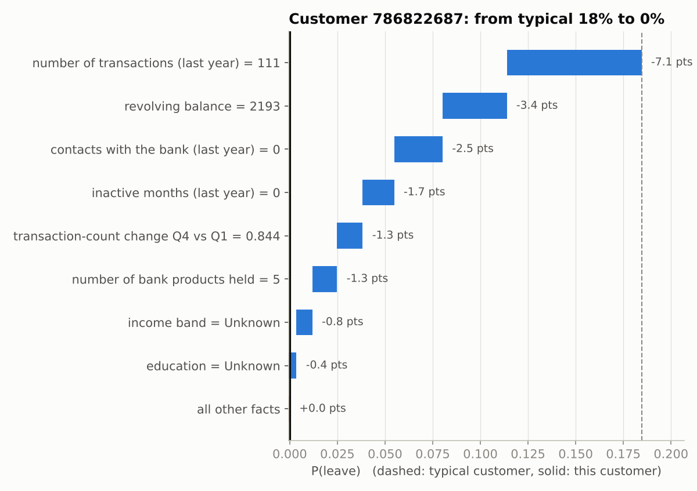
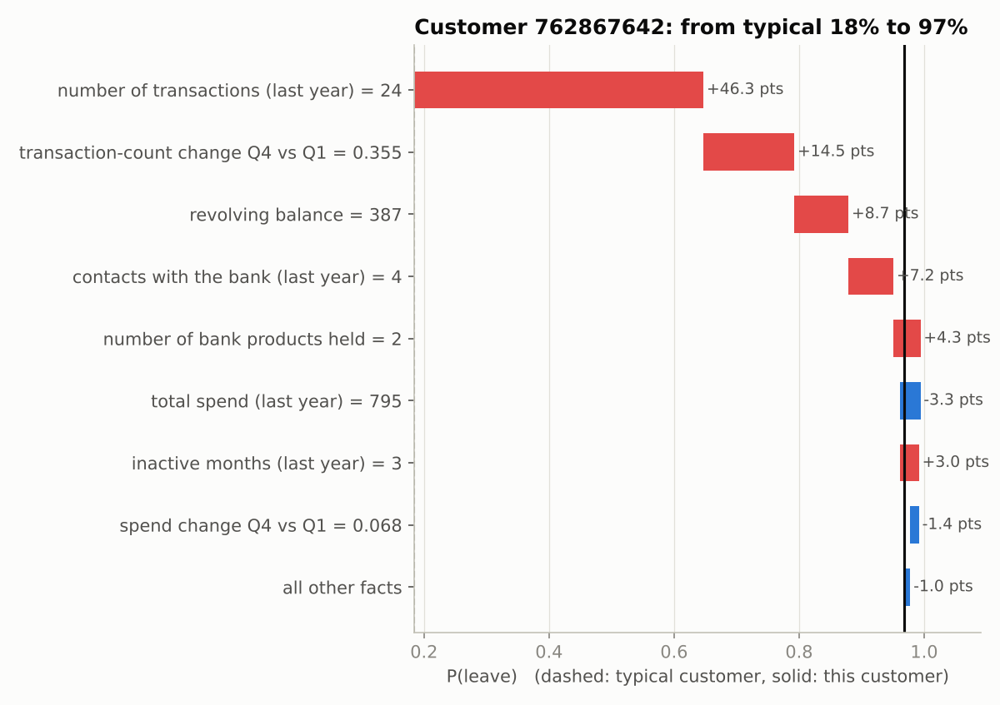
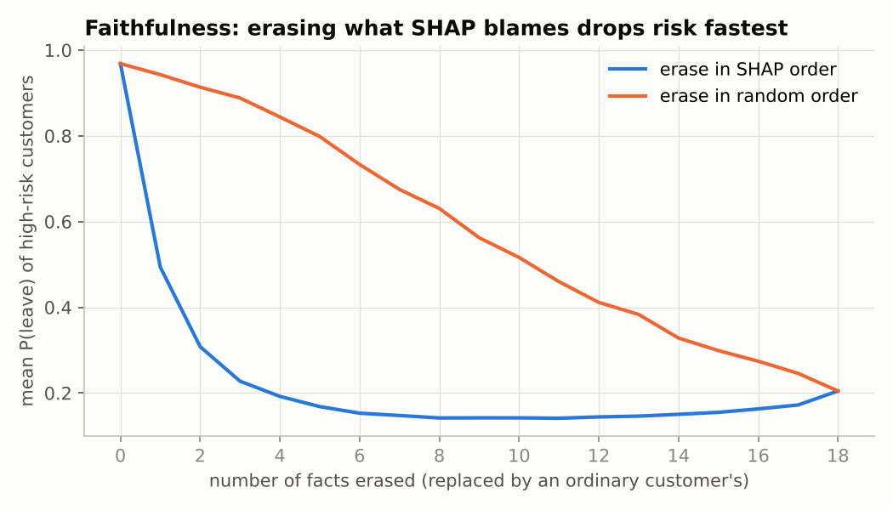

# Explainable AI report - credit-card attrition ANN

*Data:* simulated BankChurners look-alike (ground truth known). *Base attrition rate:* 16.3%.

## 0. The black box, in one paragraph

A neural network (2 hidden layers, 64 and 32 ReLU units) reads 18 facts about a cardholder and outputs the probability they will close their account. It is accurate but opaque: its knowledge is spread over thousands of weights. Below we open it in three passes - **global** (how it thinks overall), **local** (why this customer), and **trust** (whether the explanations themselves hold up).

| metric (held-out) | value |
|---|---|
| ROC-AUC | 0.901 |
| PR-AUC | 0.681 |
| F1 (attrition) | 0.615 |
| Recall of leavers | 55.9% |
| Precision on leavers | 68.3% |
| Confusion (tn/fp/fn/tp) | 1986/106/180/228 |

## 1. Global - how does the ANN think?

**Permutation feature importance**

- *In plain words:* Shuffle one column - say 'number of transactions' - so it becomes random noise, and see how much worse the ANN gets at spotting leavers. A big drop means the ANN leaned on that column heavily.
- *Analogy:* To learn which ingredient matters in a recipe, swap the sugar for a random pantry item and taste. If the cake is ruined, sugar mattered.
- *Where the simple story breaks:* If two columns carry the same information, shuffling one barely hurts (the other covers for it), so both look unimportant. It tells you HOW MUCH a feature matters, not in WHICH DIRECTION.
- *Precisely:* I_j = AUC(X, y) - E_shuffle[AUC(X with column j permuted, y)], repeated n times on held-out data; error bars are the std over repeats.

**Shapley values (SHAP)**

- *In plain words:* Start from the risk of a typical customer. Add this customer's facts one at a time and watch the risk move. A fact's credit is how much it moved the risk - averaged over every possible order of adding the facts, so nobody gets extra credit just for arriving first.
- *Analogy:* A team wins a prize. To split it fairly you ask, for every possible line-up order: how much better did the team get when this player joined? Their fair share is the average of those jumps.
- *Where the simple story breaks:* 'Remove a fact' really means 'replace it with a value from a random other customer', which can create odd combinations (e.g. huge spend but 10 transactions). Correlated features share credit. And the result says what the MODEL uses, not what CAUSES customers to leave.
- *Precisely:* phi_j = E over random orderings pi and background rows z of [f(x_{S u j}, z_rest) - f(x_S, z_rest)], with S the features before j in pi. Estimated by Monte-Carlo with antithetic (reversed) orderings. By construction sum_j phi_j = f(x) - E[f(z)] (efficiency), so the pushes add up exactly to the prediction; the small Monte-Carlo gap to the exact background mean is spread over features by their sampling variance.

**Partial dependence (PDP) and Individual Conditional Expectation (ICE)**

- *In plain words:* Take one customer and turn one dial - e.g. number of transactions - from low to high while freezing everything else. Plot the risk at each setting. That one line is ICE. Do it for many customers and average: that's the PDP, the 'shape' of the rule the ANN learned.
- *Analogy:* Adjusting the thermostat in many different houses and recording how warm each one gets. The average curve is the PDP; the spread of individual houses (ICE) shows whether every house reacts the same way.
- *Where the simple story breaks:* Freezing other features can create impossible customers (high spend with very few transactions). If ICE lines cross or fan out, the feature interacts with others and the average curve hides that.
- *Precisely:* ICE_i(v) = f(x_i with x_ij := v); PD(v) = mean_i ICE_i(v) over a quantile grid of feature j (or its categories).

**Global surrogate decision tree**

- *In plain words:* Train a small flow-chart (a decision tree with a few yes/no questions) to copy the ANN's answers. If the copy agrees with the ANN most of the time, the flow-chart is a readable summary of what the ANN does.
- *Analogy:* A student writes a one-page cheat sheet that reproduces a professor's grading. If the cheat sheet gives the same grade 95% of the time, it is a good summary of the professor's mind.
- *Where the simple story breaks:* The tree explains the ANN only as well as its fidelity score. The remaining disagreement is exactly the part the cheat sheet cannot capture. A deeper tree is more faithful but less readable - a trade-off, not a free lunch.
- *Precisely:* Fit T = argmin_tree L(tree(X), 1[f(X) >= t]) with depth <= k; report fidelity = mean(T(X_test) == ANN(X_test)) and extract each leaf's path as an IF-THEN rule with its ANN-attrition rate and support.

The depth-4 tree agrees with the ANN on **88.1%** of held-out customers (fidelity AUC 0.953). The riskiest rules it found:

| IF ... | customers | ANN says leave |
|---|---|---|
| number of transactions (last year) <= 42.50 AND revolving balance <= 830.00 | 620 | 78% |
| number of transactions (last year) <= 38.50 AND revolving balance > 1,228.00 AND transaction-count change Q4 vs Q1 <= 0.58 | 172 | 45% |
| number of transactions (last year) <= 42.50 AND 830.00 < revolving balance <= 1,228.00 | 196 | 44% |
| 42.50 < number of transactions (last year) <= 53.50 AND revolving balance <= 1,228.00 AND number of bank products held <= 4.50 | 437 | 40% |
| 53.50 < number of transactions (last year) <= 62.50 AND revolving balance <= 609.50 AND contacts with the bank (last year) > 2.50 | 222 | 29% |

## 2. Local - why THIS customer?

**LIME (Local Interpretable Model-agnostic Explanations)**

- *In plain words:* Make thousands of slightly-different copies of this customer, where some facts are swapped for an ordinary customer's facts. Ask the ANN about each copy. Then fit a simple straight-line rule that mimics the ANN *only near this customer*. The line's slopes are the explanation.
- *Analogy:* The Earth is round, but your street looks flat. LIME draws the flat street map: wrong globally, good enough locally.
- *Where the simple story breaks:* Results depend on how 'near' is defined (kernel width) and on random sampling - run it twice and the numbers wiggle. If the local fit (R^2) is poor, the straight line is lying and the explanation should not be trusted.
- *Precisely:* Sample binary masks z in {0,1}^d; build x' = x where z=1, background where z=0; weight each sample by pi(z) = exp(-(1 - mean z)^2 / w^2); solve weighted ridge f(x') ~ b0 + sum_j beta_j z_j. beta_j = local effect of 'having this customer's value of feature j'.

**Integrated Gradients**

- *In plain words:* Slide a dial from 'typical customer' to 'this customer' in small steps. At each step ask the network: if I nudge each fact a tiny bit, how much does your score move? Add up those nudges along the whole slide. Each fact's total is its share of the difference.
- *Analogy:* Hiking from a valley (typical customer) to a peak (this customer). Your total climb splits into how much you climbed while walking north versus east. Add up each direction's climb along the path.
- *Where the simple story breaks:* The answer depends on the starting point (baseline). 'Typical customer' is a choice, not a law. It works in the network's internal, scaled one-hot space, so we fold the one-hot pieces back into readable features.
- *Precisely:* IG_j(x) = (x_j - x'_j) * integral_0^1 dF(x' + a(x - x'))/dx_j da, computed on the logit F with a midpoint Riemann sum; gradients come from hand-written back-propagation. Completeness: sum_j IG_j = F(x) - F(x'). Units are log-odds.

**Counterfactual explanations**

- *In plain words:* Instead of 'why', answer 'what would need to be different?'. Search for the smallest realistic change to things the bank can influence (usage, balance, products, contacts) that makes the ANN say 'this customer stays'.
- *Analogy:* A loan officer saying 'you'd have been approved with $5k more income' - the most useful explanation is often a recipe for a different outcome.
- *Where the simple story breaks:* It shows what changes the MODEL's mind, not what will change the CUSTOMER's. There are many possible counterfactuals; we return one greedy path. Only actionable features are touched - age or gender are never 'advice'.
- *Precisely:* Greedy search: at each step move one actionable feature one step along its training-quantile grid, choosing the move with the largest drop in P(leave) per unit of cost (|change| / IQR); stop once P(leave) < threshold.

#### Case 1: Highest-risk customer who actually left (actually left)

### Customer 758246413 - risk of leaving: 100% (HIGH)

**In one sentence:** the model rates this customer high risk, mainly because of their number of transactions (last year) = 19 (typical: 65).

**The story:** a typical customer starts at **18%** risk. This customer's facts move it to **100%**:

- raises risk by +41.4 pts - number of transactions (last year) = 19 (typical: 65)
- raises risk by +15.6 pts - transaction-count change Q4 vs Q1 = 0.11 (typical: 0.71)
- raises risk by +10.6 pts - revolving balance = $0 (typical: $1,000)
- raises risk by +4.2 pts - number of bank products held = 2 (typical: 4)
- lowers risk by -2.4 pts - total spend (last year) = $1,160 (typical: $3,586)
- lowers risk by -1.0 pts - income band = $60K - $80K
- lowers risk by -0.5 pts - marital status = Single
- lowers risk by -0.4 pts - gender = M
- everything else together: +13.4 pts

**What would change the outcome:** number of transactions (last year) 19 -> 40; revolving balance $0 -> $503; number of bank products held 2 -> 6; inactive months (last year) 3 -> 2; contacts with the bank (last year) 3 -> 2 would bring the predicted risk to 49% (retain).

**How much to trust this explanation:** high. Top-3 drivers shared with LIME: 3/3, with Integrated Gradients: 3/3; LIME local fit R^2 = 0.60.

#### Case 2: Borderline case (model on the fence) (actually stayed)

### Customer 790607577 - risk of leaving: 50% (ELEVATED)

**In one sentence:** the model rates this customer elevated risk, mainly because of their number of transactions (last year) = 42 (typical: 65).

**The story:** a typical customer starts at **18%** risk. This customer's facts move it to **50%**:

- raises risk by +17.2 pts - number of transactions (last year) = 42 (typical: 65)
- raises risk by +13.6 pts - transaction-count change Q4 vs Q1 = 0.39 (typical: 0.71)
- raises risk by +12.0 pts - number of bank products held = 1 (typical: 4)
- raises risk by +1.8 pts - number of dependents = 4 (typical: 3)
- lowers risk by -6.5 pts - revolving balance = $1,224 (typical: $1,000)
- lowers risk by -5.6 pts - contacts with the bank (last year) = 2 (typical: 2)
- lowers risk by -1.5 pts - inactive months (last year) = 2 (typical: 2)
- lowers risk by -0.8 pts - marital status = Single
- everything else together: +1.2 pts

**How much to trust this explanation:** moderate. Top-3 drivers shared with LIME: 3/3, with Integrated Gradients: 3/3; LIME local fit R^2 = 0.31.

#### Case 3: Most confidently retained customer (actually stayed)

### Customer 786822687 - risk of leaving: 0% (LOW)

**In one sentence:** the model rates this customer low risk, mainly protected by their number of transactions (last year) = 111 (typical: 65).

**The story:** a typical customer starts at **18%** risk. This customer's facts move it to **0%**:

- raises risk by +0.3 pts - marital status = Divorced
- raises risk by +0.2 pts - number of dependents = 2 (typical: 3)
- raises risk by +0.1 pts - total spend (last year) = $3,865 (typical: $3,586)
- raises risk by +0.0 pts - age = 49 (typical: 46)
- lowers risk by -7.1 pts - number of transactions (last year) = 111 (typical: 65)
- lowers risk by -3.4 pts - revolving balance = $2,193 (typical: $1,000)
- lowers risk by -2.5 pts - contacts with the bank (last year) = 0 (typical: 2)
- lowers risk by -1.7 pts - inactive months (last year) = 0 (typical: 2)
- everything else together: -4.4 pts

**How much to trust this explanation:** moderate. Top-3 drivers shared with LIME: 3/3, with Integrated Gradients: 2/3; LIME local fit R^2 = 0.08.

#### Case 4: False alarm: predicted to leave, but stayed (actually stayed)

### Customer 762867642 - risk of leaving: 97% (HIGH)

**In one sentence:** the model rates this customer high risk, mainly because of their number of transactions (last year) = 24 (typical: 65).

**The story:** a typical customer starts at **18%** risk. This customer's facts move it to **97%**:

- raises risk by +46.3 pts - number of transactions (last year) = 24 (typical: 65)
- raises risk by +14.5 pts - transaction-count change Q4 vs Q1 = 0.35 (typical: 0.71)
- raises risk by +8.7 pts - revolving balance = $387 (typical: $1,000)
- raises risk by +7.2 pts - contacts with the bank (last year) = 4 (typical: 2)
- lowers risk by -3.3 pts - total spend (last year) = $795 (typical: $3,586)
- lowers risk by -1.4 pts - spend change Q4 vs Q1 = 0.07 (typical: 0.76)
- lowers risk by -0.8 pts - marital status = Unknown
- lowers risk by -0.7 pts - education = Graduate
- everything else together: +7.9 pts

**What would change the outcome:** number of transactions (last year) 24 -> 40; revolving balance $387 -> $639; number of bank products held 2 -> 5; inactive months (last year) 3 -> 2 would bring the predicted risk to 47% (retain).

**How much to trust this explanation:** high. Top-3 drivers shared with LIME: 3/3, with Integrated Gradients: 3/3; LIME local fit R^2 = 0.66.

## 3. Trust - should we believe the explanations?

- **Faithfulness.** Erasing facts in SHAP's order lowers risk faster than random order for **100%** of the highest-risk customers (area under deletion curve 0.199 vs 0.552; lower is better).
- **Internal consistency.** SHAP pushes add up to the prediction (max gap 1.1e-16); Integrated Gradients satisfy completeness (max gap 4.8e-03 log-odds); LIME's mean local fit R^2 = 0.25.
- **Agreement between methods** (average share of top-5 drivers in common):

|         |   shapley |   lime |   ig |
|:--------|----------:|-------:|-----:|
| shapley |      1    |   0.86 | 0.81 |
| lime    |      0.86 |   1    | 0.84 |
| ig      |      0.81 |   0.84 | 1    |

- **Ground truth recovery.** We planted 7 real drivers in the simulator. The 7 features SHAP ranks highest contain **6/7** of them (recall 86%): contacts with the bank (last year), inactive months (last year), transaction-count change Q4 vs Q1, number of bank products held, revolving balance, number of transactions (last year). Demographics were planted as pure noise; the highest-ranked one sits at #7 of 18.

## 4. Limits - what these explanations do NOT tell you

- They describe the **model**, not the **world**. 'Few transactions raises risk' means the ANN uses it, not that forcing transactions will stop customers leaving.
- Correlated facts (spend vs. transaction count) share credit; read them as a group.
- Perturbation methods invent hybrid customers that may be unrealistic.
- Every method has knobs (baseline, kernel width, sample size). The trust section exists so you can see when those knobs matter.
